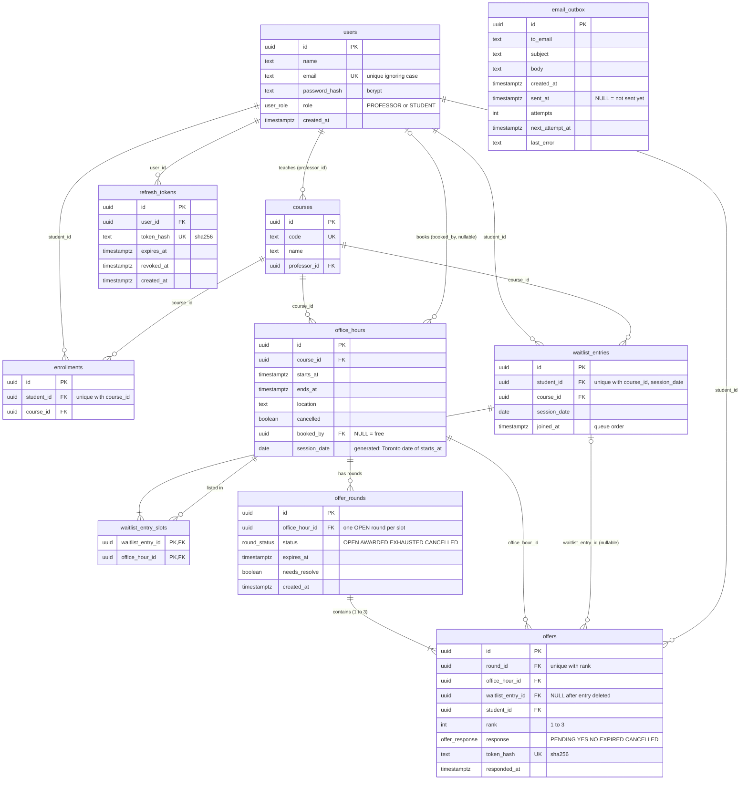
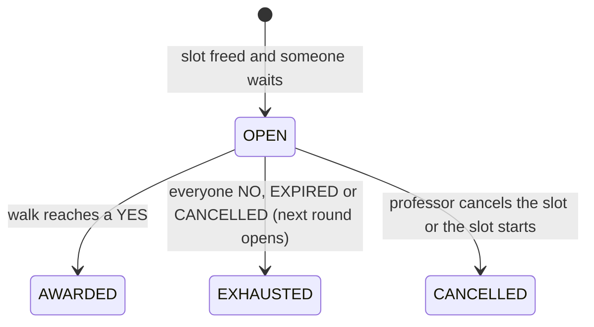
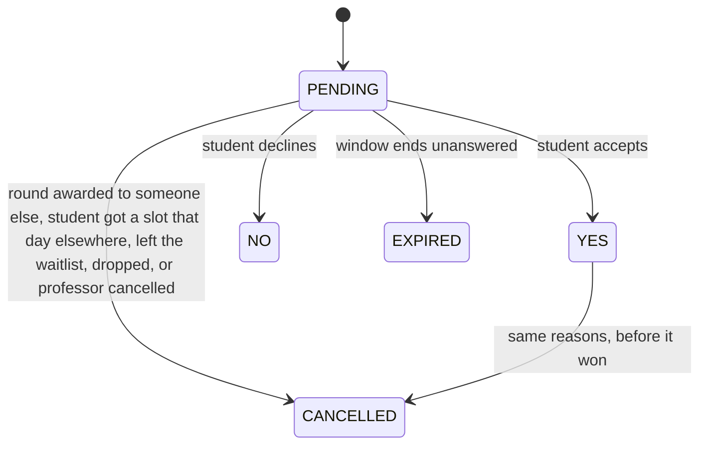

# Database schema explained

Companion to `backend/migrations/001_init.sql`. `docs/design.md` describes the operations (what each endpoint does in the database). This file explains the tables, keys and indexes themselves.

## 1. Diagram



`schema_migrations (filename, applied_at)` is not drawn: it belongs to the migration runner, not the application.

Changes from the UML diagram in the proposal: `Booking` is gone (now `office_hours.booked_by`); `location` added; `WaitlistEntry` gains `course_id` and `session_date`; `Offer` gains `student_id` and two answer values; new tables `offer_rounds`, `refresh_tokens`, `email_outbox`.

## 2. Background you need for the rest

**Primary key, UNIQUE and indexes.** An index is a sorted lookup structure, like the index of a book. It lets PostgreSQL find rows without reading the whole table. A `PRIMARY KEY` or `UNIQUE` constraint is enforced with an index that PostgreSQL creates automatically. A **unique index** rejects any insert or update that would create a duplicate, **including two concurrent transactions**: the second one waits until the first commits, then fails. That is why uniqueness rules are our concurrency guarantees.

**Foreign keys do not get an index automatically** in PostgreSQL. `REFERENCES` only checks that the referenced row exists. Searching by a foreign key column is a full table scan unless we add an index.

**Plain indexes** (`CREATE INDEX`) are only about speed; they never change what the database accepts. **Unique indexes** (`CREATE UNIQUE INDEX`) are rules.

Honest caveat: with a course project's data (hundreds of rows), PostgreSQL reads a whole table in microseconds, so the plain indexes are not needed for performance today. Each one matches a query the app runs often, so it is cheap and correct to have them. They could be removed without breaking anything.

## 3. Table by table

### `users`
One table for both roles; `role` is an enum, so PostgreSQL rejects any value other than `PROFESSOR` or `STUDENT`.

**Why `CREATE UNIQUE INDEX users_email_lower ON users (lower(email))` instead of `email text UNIQUE`?** `UNIQUE` compares exactly, so `Ana@Example.com` and `ana@example.com` would be two different accounts for the same mailbox. The index stores `lower(email)` and makes *that* unique, so the second registration fails whatever the capitals. Login looks up `WHERE lower(email) = lower($1)`, which the same index serves.

The common alternative is to lowercase emails in Node before saving and keep a plain `UNIQUE`. It works equally well, but if any code path forgets to lowercase, the duplicate gets in. The index makes the database enforce it. (A third option, the `citext` case-insensitive text type, needs an extension.)

### `courses`
`code UNIQUE` because two courses called ECE1779 would be ambiguous (API returns 409). `professor_id` references `users`; the API checks the user is a professor.

### `enrollments`
`UNIQUE (student_id, course_id)`: enrolling twice fails (409). That unique index also serves "which courses is this student in", because its first column is `student_id`.

### `office_hours`
The booking lives here: `booked_by` is `NULL` when free, a student id when booked. A slot has one column, so two students in one slot is impossible by construction (hard problem 1). Booking is `UPDATE ... SET booked_by` on a locked row (design section 4).

`cancelled` is a flag instead of deleting the row, so history and old offers keep pointing at a real row. That's why nothing references `office_hours` with `ON DELETE CASCADE`: slots are never deleted.

`CHECK (ends_at > starts_at)` rejects backwards times even if the API check is ever skipped.

**`session_date`** is a *generated column*: PostgreSQL computes it from `starts_at` on every insert or update; nobody can write it. `starts_at AT TIME ZONE 'America/Toronto'` converts the UTC instant to Toronto wall-clock time, `::date` keeps the day. Example: `2026-11-13 03:00 UTC` is 22:00 on Nov 12 in Toronto, so `session_date` is `2026-11-12`. Using the UTC date would put a 22:00 slot on the wrong day. Daylight saving time is handled by PostgreSQL's time zone database. `STORED` means it is saved on disk, so it can be indexed.

**`one_booking_per_session`, how it works:**

```sql
CREATE UNIQUE INDEX one_booking_per_session
  ON office_hours (booked_by, course_id, session_date)
  WHERE booked_by IS NOT NULL AND NOT cancelled;
```

It says: among booked, non-cancelled slots, no two may share the same (student, course, day). In other words a student holds at most one live booking per course per Toronto day.

- It is a **partial** index: only rows matching `WHERE` are in it. Rows outside the `WHERE` are never compared.
- `NOT cancelled`: if a professor cancels Ana's Tuesday slot, that row leaves the index, so Ana can book another Tuesday slot. (`booked_by` stays on the cancelled row as a record.)
- `booked_by IS NOT NULL`: free slots are not bookings. Strictly this condition is redundant, because PostgreSQL treats NULLs as distinct in unique indexes, so free slots would never clash anyway. It keeps the index small and makes the intent readable.
- It must be a unique *index*, not a `UNIQUE` constraint, because constraints cannot have a `WHERE`.
- Concurrency: if Ana books two Tuesday slots at the same instant from two tabs, each transaction locks a different slot row, so the row locks don't stop them. The unique index does: the second commit fails with a unique violation, which the API turns into 409 "already booked this session".
- Tested on 2026-11-05: booking a second slot on the same Toronto day failed with this constraint; the next day succeeded.

**`office_hours_course_time ON office_hours (course_id, starts_at)`** is a plain speed index for the most common read: "slots of course X between dates, in time order" (`GET /student/office-hours`, `GET /professor/office-hours`). Rows are sorted by course, then time, so PostgreSQL jumps to the course and reads the range in order. It enforces nothing.

### `waitlist_entries`
One row per student per session (course plus day): `UNIQUE (student_id, course_id, session_date)`, so joining the same session twice fails (409). `joined_at` is the queue order. `session_date` here is a plain column copied from the listed slots; the API checks every listed slot has that course and day.

### `waitlist_entry_slots`
A **join table**: an entry lists many slots, and a slot is listed by many entries (many-to-many). One row = "entry E would accept slot S".

- `PRIMARY KEY (waitlist_entry_id, office_hour_id)`: the same slot can't be listed twice in one entry. A separate `id` column would add nothing.
- `ON DELETE CASCADE` on `waitlist_entry_id`: deleting an entry (leave, win, book, drop) deletes its rows here automatically. No cascade on `office_hour_id`, because slots are never deleted.
- **Why the extra `CREATE INDEX waitlist_entry_slots_slot ON (office_hour_id)`?** The primary key's index is sorted by `waitlist_entry_id` first. That makes "which slots does entry E list" fast, but "which entries list slot S" would scan the whole table, like looking up a surname in a phone book sorted by first name. The second question is the one the offer round asks every time a slot frees up, and the one professor cancellation asks. The extra index is sorted by slot.

## 4. Offer rounds and offers

There is no table called `offers_entries`; you may mean the index `offers_entry`, explained below.

A **round** is one attempt to fill one freed slot: one `offer_rounds` row plus up to three `offers` rows (one per invited student, ranks 1 to 3). If the round fails, a new round row is created for the next students. A slot can therefore have many rounds over time, but **at most one `OPEN` at a time**.

Example: Bob cancels slot S. Ana, Carl and Dee (in `joined_at` order) list S.

```
offer_rounds: R1  slot=S  status=OPEN  expires_at=15:05
offers:       rank 1 Ana  PENDING
              rank 2 Carl PENDING
              rank 3 Dee  PENDING
```
Carl says YES: `WAITING`, because Ana hasn't answered. Ana says NO: the walk passes Ana, reaches Carl's YES, and awards. `booked_by = Carl`, R1 `AWARDED`, Dee's offer `CANCELLED`, Carl's waitlist entry for that day deleted. If instead all three said NO (or timed out), R1 becomes `EXHAUSTED` and R2 opens for the next three entries; Ana, Carl and Dee are skipped because they already have an offer for S (rule 6).

Round states:


Offer states:


Columns:
- `offer_rounds.expires_at`: one deadline per round, stored in the database so it survives pod restarts (hard problem 2). Set to `least(now() + window, starts_at)` so an offer never runs past the slot's start.
- `offer_rounds.needs_resolve`: a "please look at me" flag. When an offer is cancelled from outside its round (for example Ana won another slot), her other rounds may now be decidable. Rather than locking those other slots mid-transaction (deadlock risk, design section 3), we set the flag and the worker resolves them within about two seconds.
- `one_open_round_per_slot` (unique, partial `WHERE status = 'OPEN'`): two open rounds for one slot is impossible even if two pods race. Closed rounds are outside the index, so history is unlimited. Tested on 2026-11-05.
- `offer_rounds_due` (partial, on `expires_at WHERE status = 'OPEN'`): the worker asks "open rounds past their deadline" every two seconds on every pod. This index holds only open rounds, sorted by deadline.
- `offers.round_id` plus `UNIQUE (round_id, rank)`: one rank 1, one rank 2, one rank 3 per round. The unique index also serves "offers of round R in rank order", which the resolve walk reads.
- `offers.student_id`: who was asked. Kept separately because the entry can be deleted while the round still needs this offer.
- `offers.waitlist_entry_id ... ON DELETE SET NULL`: when an entry is deleted, its offers stay (round history) with this column set to NULL. `CASCADE` would delete offers that a running round still needs; plain `REFERENCES` would refuse to delete the entry at all.
- `offers.office_hour_id`: the same as the round's slot, copied here so the rule-6 check ("has entry E been offered slot S before") reads one table.
- **`offers_entry ON offers (waitlist_entry_id)`**: two uses. Removing an entry first runs "cancel this entry's pending offers", a lookup by `waitlist_entry_id`. Then `ON DELETE SET NULL` makes PostgreSQL itself find every offer pointing at the deleted entry. Without the index, both are full scans of `offers`, a table that only grows.

## 5. Tokens

Three kinds of credentials. Only the hash of a token is ever stored, never the token itself.

| | Offer token | Refresh token | Access token (JWT) |
|---|---|---|---|
| Where | link in the offer email | httpOnly cookie | JavaScript memory, `Authorization` header |
| Lifetime | one round (≤ 5 min), single use | 7 days, replaced on every refresh | 15 minutes |
| Stored | `offers.token_hash` (sha256) | `refresh_tokens.token_hash` (sha256) | not stored; verified by signature with `JWT_SECRET` |

- **Why hash tokens?** If the database or a backup in Spaces leaks, the hashes can't be turned back into working links or sessions. On each request Node computes `sha256(received token)` and looks it up; the `UNIQUE` on `token_hash` gives the index for that lookup.
- **Why sha256 here but bcrypt for passwords?** A token is 32 random bytes (256 bits): nobody can guess it, so a fast hash is enough. Passwords are short, human-chosen and guessable, so they need bcrypt, which is deliberately slow and salted to make guessing expensive.
- **Offer links** look like `/offer.html#<token>`. Everything after `#` stays in the browser and is never sent in the page request. The page's JavaScript reads it, shows the offer (`GET /offers/{token}`), and only the button press sends `POST .../respond`. A mail scanner that prefetches the link loads a harmless page and changes nothing.
- **Refresh tokens**: `revoked_at` is set on logout and when the token is used to refresh (rotation: each refresh returns a new token and kills the old one). If a revoked token is presented again, someone copied it, so all of that user's refresh tokens are revoked. `expires_at` caps it at 7 days.

## 6. Email outbox

Emails are not sent where they are decided. The transaction that creates offers (or awards a slot, or cancels a booked slot) inserts a row into `email_outbox`; the row commits or rolls back together with the decision. A loop in every backend pod sends unsent rows.

- `sent_at NULL` = still to send. Set after the email provider accepts it.
- `attempts`, `next_attempt_at`, `last_error`: on failure the row is retried later (backoff) and the error kept for debugging.
- Rows are taken with `FOR UPDATE SKIP LOCKED`, so two pods never send the same row at the same time.
- `email_outbox_unsent` (partial, `WHERE sent_at IS NULL`): the loop's query touches only unsent rows, and the index excludes the ever-growing sent history.
- At least once, not exactly once: if a pod dies after sending but before marking the row, the email goes out again. Accepted.

## 7. `schema_migrations`

Created by `scripts/migrate.js`, not by `001_init.sql`. One row per applied file. The runner skips files already listed, so running it again (every deploy) changes nothing.
